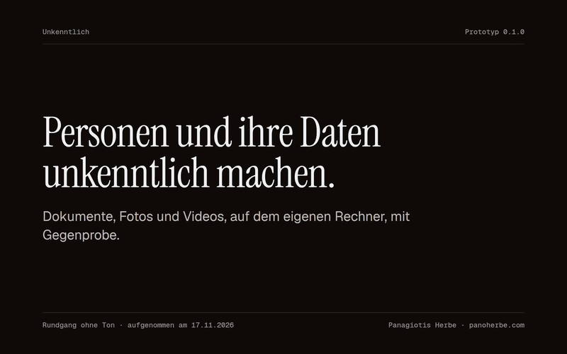
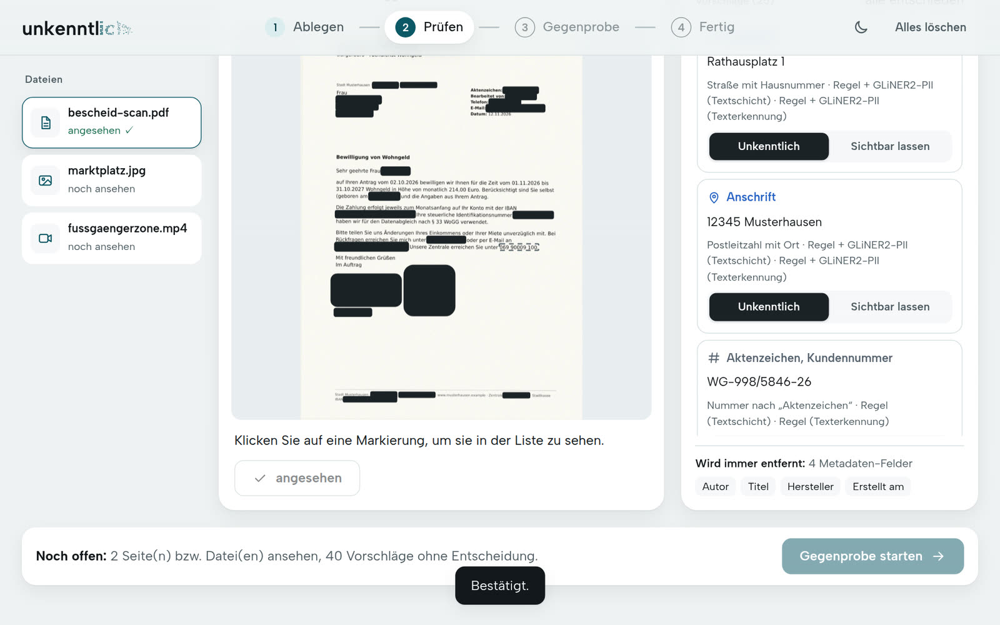
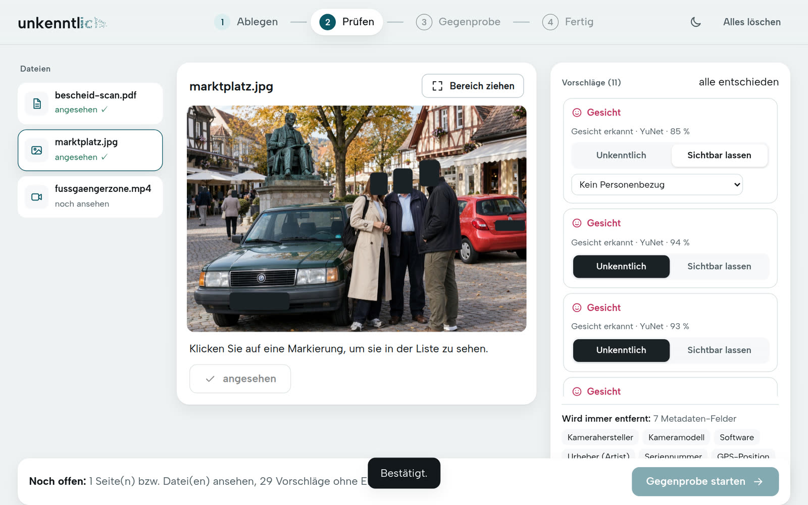
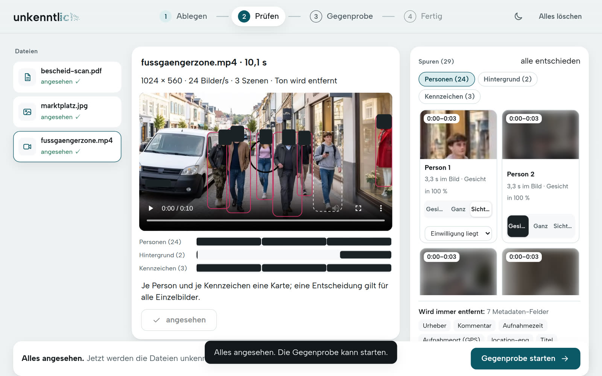
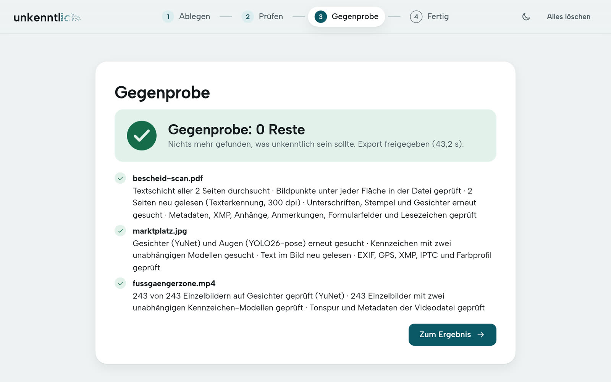

<p>
  <picture>
    <source media="(prefers-color-scheme: dark)" srcset="medien/wortmarke-dunkel.svg">
    
  </picture>
</p>

**Personen und ihre Daten in Dokumenten, Fotos und Videos unkenntlich machen, auf dem eigenen Rechner.**

Unkenntlich schlägt jede Stelle vor, ein Mensch entscheidet, dann werden die Inhalte wirklich entfernt. Eine Gegenprobe
sucht auf dem Ergebnis noch einmal und gibt den Export erst frei, wenn sie nichts mehr findet. Ein Prüfbericht hält
fest, was geschah. Ein offener Prototyp, der heute läuft, ohne Internet und ohne Grafikkarte, gestartet mit Docker;
Installationspakete für Windows und Linux folgen.

**Auf einen Blick:** ① Dateien ablegen → ② Vorschläge ansehen, der Mensch entscheidet → ③ Inhalte wirklich entfernen →
④ Gegenprobe gibt den Export frei → ⑤ Prüfbericht, ohne die Daten selbst.

**Für wen:** Behörden und Kommunen, die Akten nach Informationsfreiheits- und Transparenzgesetzen herausgeben; Ämter,
Vereine und kleine Unternehmen, die DSGVO-Auskünfte mit Fotos oder Kameraaufnahmen beantworten; Redaktionen,
Initiativen und Schulen, die Bilder von Menschen zeigen; alle, die eine Kopie weitergeben und vorher etwas schwärzen.



<sub>Rundgang: 91 Sekunden, sechs Szenen, ohne Ton; aufgenommen am 18.11.2026 in einer frischen Installation (Version 0.2.0), nur auf der CPU gerechnet. Erkennung und Gegenprobe liefen ohne Aufnahme; die Untertitel nennen ihre Dauer aus dem Messlauf (die Oberfläche zeigt die Dauer dieser Aufnahme, in der der Browser mitrechnet). Das Schreiben ist erfunden (simuliert); Foto und Video sind mit offenen Modellen erzeugt: **keine echten Personen, keine echten Kennzeichen** ([Quellen](pruefsatz/QUELLEN.md)). Bewegtes Bild oben: 4,7 MB. [Video herunterladen (MP4, 3,6 MB)](https://github.com/panoherbe/unkenntlich/raw/main/medien/rundgang.mp4) · Text des Rundgangs weiter unten.</sub>

<p align="center">
  
  
  
  
</p>

<sub>Bilder aus dem Rundgang: Schreiben erfunden (simuliert), Foto und Video mit offenen Modellen erzeugt (keine
echten Personen, keine echten Kennzeichen, [Quellen](pruefsatz/QUELLEN.md)).</sub>

## Warum es Unkenntlich braucht

Kurz: Transparenz und Datenschutz treffen täglich aufeinander, und Schwärzen ist heute meist Handarbeit.

- Die Bundesbehörden bearbeiteten 2025 18.982 Vorgänge nach dem Informationsfreiheitsgesetz, 17 Prozent mehr als 2024
  ([BT-Drs. 21/8592](https://dserver.bundestag.de/btd/21/085/2108592.pdf)); dazu kommen Länder, Kommunen und
  DSGVO-Auskünfte von Ämtern, Vereinen und Unternehmen.
- In einer Untersuchung von knapp 5.000 Behörden-PDFs ließen sich Schwärzungen rekonstruieren, bei einer Behörde 83
  Passagen ([Golem](https://www.golem.de/news/behoerden-pdfs-vertrauliche-daten-trotz-schwaerzung-rekonstruierbar-2609-212878.html),
  [Begleitbeitrag](https://oliverjessner.at/blog/2026-09-14-pdfs-richtig-schwaerzen-warum-ein-schwarzer-balken-nicht-reicht/)).
- Der Bayerische Landesbeauftragte für den Datenschutz verlangt nach jeder Schwärzung eine abschließende Kontrolle und
  rät von frei zugänglichen Online-Werkzeugen ab
  ([Aktuelle Kurz-Information 66](https://www.datenschutz-bayern.de/datenschutzreform2018/aki66.pdf)).

Unkenntlich bringt Transparenz und Datenschutz zusammen: lokal, mit dem Menschen als Entscheider, mit einer Gegenprobe vor jedem Export und
einem Prüfbericht.

## Was Unkenntlich kann, läuft hier schon

Kurz: Jede Zeile ist umgesetzt. Jede Zahl stammt aus dem Messlauf vom 18.11.2026 ([Messprotokoll](nachweis/PROTOKOLL.md),
Rohdaten [`nachweis/messwerte.json`](nachweis/messwerte.json)). Die zwölf Schreiben sind erfunden, Fotos und Video mit
offenen Modellen erzeugt, und der Mensch, der im Messlauf bestätigt, ist ein Skript: alles **simuliert**.

| Was Sie brauchen | Läuft hier schon | Gemessen am 18.11.2026 |
|---|---|---|
| Angaben im Text finden | Namen, Anschriften, Telefon, E-Mail, IBAN, Steuer-ID, Geburtsdatum, Akten- und Kundennummern, Kennzeichen; feste Regeln mit Prüfziffer plus ein offenes Modell; in digitalen PDFs, in Scans (Texterkennung) und in der unsichtbaren Textschicht eines Scanners; ein Name wird im ganzen Dokument gesucht | 215 von 215 Angaben im Text vorgeschlagen, in 12 erfundenen Schreiben (simuliert); mit Unterschriften und Stempeln 231 von 235; 3,7 Vorschläge je Seite ohne eingesetzte Angabe, meist Anschrift und Zentrale des Absenders |
| Unterschriften und Stempel | ein Bildmodell schlägt Bereiche vor; was fehlt, zieht man mit „Bereich ziehen“ selbst | Unterschriften 12 von 12 abgedeckt (6 als Unterschrift erkannt), Stempel 4 von 8 (simuliert; rechteckige Firmenstempel erkennt das Modell nicht) |
| Gesichter und Kennzeichen in Fotos | Gesichter, Köpfe auch von hinten, Kennzeichen mit zwei Modellen, Text im Bild; deckend überschrieben, nicht verpixelt | 4 erzeugte Fotos (1536 × 1024): Erkennung je 0,6 bis 0,7 s auf der CPU; EXIF und GPS danach entfernt |
| Personen im Video | jede Person über alle Einzelbilder verfolgt, eine Karte und eine Entscheidung je Person (Gesicht, ganze Person oder sichtbar lassen), Kennzeichen ebenso; Zeitleiste; nach einem Schnitt beginnen alle Spuren neu | erzeugtes Video, 10 s in drei Szenen (1024 × 560): 22 Personen, 4 weitere Gesichter, 3 Kennzeichen; beide Schnitte erkannt; Erkennung 49 s auf der CPU |
| Wirklich entfernen | Text und Bildpunkte unter jedem Balken, Metadaten, XMP, Anhänge, Anmerkungen, Formularfelder, Lesezeichen; EXIF und GPS; Ton und Metadaten im Video | zweite, unabhängige Prüfung: 0 von 148 eingesetzten Angaben im Ergebnis noch lesbar; Kontrollversuch „nur schwarz übermalt“: Gegenprobe findet den Inhalt unter den Kästen in 10 von 10 PDFs (Text in der Textschicht in 8, Bildpunkte unter den Flächen in 10) und sperrt alle 10 |
| Gegenprobe vor dem Export | feste Regeln und eine Wortsuche nach jeder bestätigten Angabe (in der Textschicht und in einer neuen Texterkennung), die Bildpunkte unter den Flächen; Gesichter und Kennzeichen erneut gesucht, im Video auf jedem Einzelbild, in Schreiben auch Unterschriften und Stempel; bei einem Rest bleibt der Export gesperrt, der Rest wird ein neuer Vorschlag; bleibt er auch danach, deckt die nächste Runde in Fotos und Videos großzügiger ab, und als letzter Ausweg wird die Datei nicht herausgegeben | am Ende 0 Reste in allen 17 Dateien; zuerst fand sie in einem Schreiben und einem Foto je 1 Rest (gesperrt, übernommen, dann 0); Kontrollversuch Video: jedes zehnte Einzelbild unbearbeitet, gefunden in 24 von 24 |
| Prüfbericht | PDF und HTML: jede Stelle mit Kategorie, Ort, Entscheidung, Grund für „sichtbar“, Prüfsummen, Protokoll; ohne die Daten selbst | im Test geprüft: keine Angabe im Klartext, auch nicht im Grund eines Vorschlags |
| Ohne Internet | Modelle beim Bauen geladen, mit Prüfsumme; danach braucht Unkenntlich kein Netz | Messlauf ohne Netz (network_mode: none) |
| Barrierefrei bedienbar | Tastatur, sichtbarer Fokus, Schieber mit Pfeiltasten, helles und dunkles Schema, Telefon | 0 Verstöße laut axe-core 4.14.1 (WCAG 2.2 AA) in 16 Ansichten, dazu 14 Stellen zur Handprüfung (Farbkontrast über Bildern, Untertitel und ein Attribut am Video) |
| Geprüfte Qualität | automatische Tests | 19 von 19 Tests bestanden (15 s) |

## In zwei Minuten selbst prüfen

Kurz: Unkenntlich startet mit einem Befehl auf Ihrem Rechner. Eine Online-Vorführung gibt es absichtlich nicht: Die
Dateien sollen den Rechner nicht verlassen.

Mit [Docker Desktop](https://www.docker.com/products/docker-desktop/) (Windows, macOS oder Linux):

```bash
git clone https://github.com/panoherbe/unkenntlich.git
cd unkenntlich
docker compose up -d --build
```

Dann http://localhost:8080 öffnen und **„Beispiele laden“** klicken. Das erste Bauen lädt Bibliotheken und die freien
Modelle (Image 4,5 GB, davon 1,7 GB Modelle, [gemessen](nachweis/image-groesse.txt)) und dauert je nach Leitung einige Minuten; danach braucht
Unkenntlich kein Netz mehr. Die Erkennung der drei Beispiele dauert auf einem Rechner ohne Grafikkarte etwa eine
Minute (Messprotokoll: Schreiben 13 s, Foto 0,7 s, Video 49 s).

Zum Ausprobieren: Im Schreiben eine Stelle auf „Sichtbar lassen“ stellen, mit „Bereich ziehen“ etwas selbst
markieren, im Video eine Person auf „Sichtbar“ stellen. Dann „Gegenprobe starten“ und am Ende den Schieber ziehen.

Den ganzen Messlauf wiederholen (Tests, Erkennung, Gegenprobe, Kontrollversuche; etwa 5 Minuten, ohne Netz):

```bash
docker compose -p unkenntlich-nachweis -f compose.nachweis.yaml run --rm messung
```

## Was Sie heute schon prüfen können

Kurz: Ablauf, Gegenprobe und Messung liegen offen.

- **Wirklich entfernt, nicht nur überdeckt.** Im PDF verschwinden Text und Bildpunkte unter jedem Balken, dazu
  Metadaten, XMP, Anhänge, Anmerkungen, Formularfelder, Lesezeichen und Verknüpfungen; Fotos verlieren EXIF und GPS,
  Videos Ton und Metadaten. Der Kontrollversuch im Messprotokoll malt absichtlich nur schwarze Kästen über den Text: Die
  Gegenprobe findet den Inhalt darunter (im digitalen PDF in der Textschicht, im Scan in den Bildpunkten der Datei) und
  sperrt den Export.
- **Der Mensch entscheidet.** Jeder Vorschlag nennt Kategorie, Grund und Quelle (Regel oder Modell). Exportieren geht
  erst, wenn jede Seite, jedes Bild und jedes Video angesehen ist.
- **Der Prüfbericht verrät nichts.** Er nennt Kategorie, Ort, Entscheidung und Prüfsummen, aber keine der
  unkenntlich gemachten Angaben, auch nicht im Grund eines Vorschlags ([Tests](tests/test_schwaerzen.py)). Vorschauen
  des Ergebnisses gibt es erst, wenn die Gegenprobe den Export freigibt.
- **Kein Export durch die Hintertür.** Solange die Gegenprobe Reste meldet, sind Ergebnis, ZIP, Ergebnisvorschau und
  Ergebnisvideo gesperrt ([Test](tests/test_api.py)). Bleibt ein Rest ohne Ort (etwa Metadaten), baut Unkenntlich das
  Dokument im nächsten Durchlauf aus Seitenbildern neu auf, damit der Export nicht für immer gesperrt bleibt.
- **Ein Ausweg auch für Fotos und Videos.** Findet die Gegenprobe nach einer Übernahme in einem Foto oder Video noch
  einen Rest, deckt die nächste Runde großzügiger ab: doppelt so groß, im Foto mit angrenzenden Flächen zusammengelegt,
  im Video länger nachgeführt. Nach jeder Übernahme lässt sich eine Datei mit Resten (jeder Art) auch vom Export
  ausnehmen: Sie wird nicht herausgegeben, ihr Ergebnis ist nicht abrufbar, und der Prüfbericht nennt sie mit ihren
  Resten. Übergangen wird ein Rest nie ([Test](tests/test_schwaerzen.py)).

## Text des Rundgangs

<details>
<summary>Die Sätze im Video (aufklappen)</summary>

| ab | Satz | klein darunter |
|---|---|---|
| 0:00 | Titelkarte: „Personen und ihre Daten unkenntlich machen.“ | Dokumente, Fotos und Videos, auf dem eigenen Rechner, mit Gegenprobe. |
| 0:04 | Drei Dateien ablegen: ein Schreiben, ein Foto, ein Video. | Alles bleibt auf diesem Rechner, ohne Internet. |
| 0:10 | Drei Dateien ablegen: ein Schreiben, ein Foto, ein Video. | Erkennung auf der CPU: 62 s für alle drei Dateien (Messlauf), das Video braucht am längsten. |
| 0:19 | Jede Stelle mit Grund. Sie entscheiden. | Name, Anschrift, IBAN, Steuer-ID, Unterschrift: jede Stelle einzeln. |
| 0:24 | Jede Stelle mit Grund. Sie entscheiden. | Die Zentrale der Behörde bleibt sichtbar; der Grund steht im Prüfbericht. |
| 0:30 | Jede Stelle mit Grund. Sie entscheiden. | Den Stempel hat das Modell nicht gefunden: einen Rahmen selbst ziehen. |
| 0:36 | Jede Stelle mit Grund. Sie entscheiden. | Angesehen: Die übrigen Vorschläge werden unkenntlich. |
| 0:41 | Gesichter und Kennzeichen im Foto. | Eine Statue ist keine Person: sichtbar lassen. |
| 0:47 | Im Video: eine Karte je Person, über alle Einzelbilder. | Wer eingewilligt hat, bleibt sichtbar (erzeugte Person, Einwilligung simuliert). |
| 0:55 | Gegenprobe: alles wird auf dem Ergebnis erneut gesucht. | Findet sie noch etwas, bleibt der Export gesperrt. |
| 1:02 | Gegenprobe: alles wird auf dem Ergebnis erneut gesucht. | 0 Reste: Export freigegeben. Gegenprobe auf der CPU: 35 s (Messlauf). |
| 1:09 | Vorher, nachher und ein Prüfbericht. | Der Bericht nennt jede Stelle und jede Entscheidung, aber keine der Daten. |
| 1:15 | Messkarte: „Gemessen am 18.11.2026“ | 215 von 215 Angaben im Text vorgeschlagen, 12 erfundene Schreiben (simuliert), mit Unterschriften und Stempeln 231 von 235; 0 Reste laut Gegenprobe in 12 Schreiben, 4 Fotos und 1 Video (Fotos und Video erzeugt); 4,8 s Erkennung je Sekunde Video (1024 × 560 Bildpunkte), nur CPU; 0 Verstöße (axe-core), hell und dunkel, 14 Stellen zur Handprüfung. |
| 1:24 | Schlusskarte: „Selbst ausprobieren“ | github.com/panoherbe/unkenntlich; `docker compose up`, dann im Browser, ohne Internet. Code AGPL-3.0-or-later; Schreiben erfunden (simuliert, CC0); Foto und Video erzeugt mit MOSS-Image-SFT und Vimoo-1.0-Lite (Apache-2.0): keine echten Personen, keine echten Kennzeichen (CC0); Panagiotis Herbe. |

</details>

## Stand heute und nächste Schritte

Kurz: Ein laufender, gemessener Anfang. Die nächsten Schritte machen Unkenntlich alltagstauglich.

**Heute:**

- **Gemessen auf Testdateien:** zwölf erfundene Schreiben aus drei Vorlagen, vier erzeugte Fotos und ein erzeugtes
  Video. Die Zahlen zeigen, dass der Ablauf trägt; echte Akten und Aufnahmen sind vielfältiger (Licht, Unschärfe,
  Gedränge), dafür kommt der größere Prüfsatz.
- **Die Gegenprobe ergänzt den Blick des Menschen:** Sie findet, was ihre Erkenner erkennen. Was keines der Modelle
  sieht, markiert der Mensch mit „Bereich ziehen“ (im Messlauf zum Beispiel einige Stempel). Umgekehrt schlagen die
  Modelle auch vor, was ein Mensch sichtbar lässt, etwa das Gesicht einer Statue oder den Kopf einer Schaufensterpuppe.
- **Video:** ohne Grafikkarte etwa 5 Sekunden Erkennung und 3 Sekunden Gegenprobe je Videosekunde (Messlauf: ein
  erzeugtes Video von 10 Sekunden). Ton wird ganz entfernt.
- **Dateien:** PDFs, Scans, Fotos und Videos; Office-Dateien vorher als PDF speichern. Dateinamen bleiben erhalten; ein Name
  im Dateinamen wird von Hand geändert. Nicht im Prototyp: Handschrift als Text lesen und Livebilder.
- **Barrierefreiheit:** automatisch geprüft (axe-core); der Test mit Bildschirmlesern folgt.

**Als Nächstes:**

1. Die Text-Erkennung von [OpenRedact](https://gitlab.opencode.de/openredact/open-redact) einbinden, mit der eigenen
   Erkennung als Ausweichweg, und vorher und nachher messen.
2. Ein größerer offener Prüfsatz mit schwierigen Fällen: schlechte Scans, Gedränge, Dunkelheit.
3. Stempel zuverlässiger, Text im Video (Schilder, Bildschirme), Video ohne Grafikkarte doppelt so schnell.
4. Tests mit Anwenderinnen und Anwendern aus Verwaltung, Verein, Redaktion und Schule.
5. Pakete für Windows und Linux ohne Docker, Anleitungen, Test mit Bildschirmlesern.
6. Version 1.0 mit Messbericht.

## Mitmachen und Kontakt

Rückmeldungen, schwierige Testfälle (bitte ohne echte Personendaten) und Mitstreiterinnen und Mitstreiter sind
willkommen: als Issue auf GitHub oder über [panoherbe.com](https://www.panoherbe.com).

Panagiotis Herbe

---

## Für Ihre IT

Kurz: ein Programm, das man im Browser bedient und das ganz auf dem eigenen Rechner läuft; alle Modelle liegen bei,
nichts geht nach außen.

| | |
|---|---|
| Server | Python 3.13, FastAPI; Erkennung nacheinander in einem Hintergrund-Faden |
| Oberfläche | HTML, CSS, JavaScript-Module ohne Build-Schritt, keine Fremdbibliotheken; Schriften Albert Sans und IBM Plex Mono (OFL) im Paket |
| Dokumente | PyMuPDF: Textschicht mit Wortpositionen, Schwärzen mit Entfernen von Text, Bildpunkten und überdeckter Vektorgrafik, danach Anmerkungen, Formularfelder und Lesezeichen löschen, `scrub` und Neuschreiben ohne alte Versionen; bleibt ein Rest ohne Ort, wird das Dokument aus Seitenbildern neu aufgebaut |
| Bilder und Video | OpenCV, FFmpeg (H.264, ohne Ton und Metadaten); Vorschau im Browser als WebM |
| Sicherheit | Content-Security-Policy nur für die eigene Adresse, keine Cookies, keine Konten; Port nur auf `127.0.0.1`; Modelle beim Bauen mit fester Prüfsumme geladen ([`werkzeuge/modelle_laden.py`](werkzeuge/modelle_laden.py)), zur Laufzeit `HF_HUB_OFFLINE=1`, `YOLO_OFFLINE=1`, Statistik von Ultralytics aus |
| Daten | je Vorgang ein Ordner im Volume `daten`; „Alles löschen“ entfernt ihn vollständig |
| Tests | `docker compose run --rm test` (19 Tests, 4 warnings, ohne Netz) |
| Nachweise | [Messprotokoll](nachweis/PROTOKOLL.md), [Barrierefreiheit](nachweis/barrierefreiheit.json), Prüfsatz mit Wahrheit ([`pruefsatz/`](pruefsatz/)) |

### Modelle und Lizenzen (geprüft am 17.11.2026)

Gewählt wurde je Aufgabe die neueste frei lizenzierte Generation, die ohne Grafikkarte schnell genug läuft und ohne
Anmeldung zu laden ist. Die Lizenz der Gewichte steht so, wie das jeweilige Repository sie angibt.

| Aufgabe | Modell | Lizenz laut Repository | Warum dieses |
|---|---|---|---|
| Namen, Anschriften und weitere Angaben im Text | [GLiNER2-PII multi](https://huggingface.co/fastino/gliner2-privacy-filter-PII-multi) (205 M Parameter, Stand 28.09.2026) | Apache-2.0 | eigens für personenbezogene Daten, auch Deutsch, läuft auf der CPU in Zehntelsekunden; die neuere Familie GLiNER2.5 gibt es am 17.11.2026 nur als allgemeines Modell, nicht für personenbezogene Daten |
| IBAN, Steuer-ID (mit Prüfziffer), Telefon, E-Mail, Geburtsdatum, Aktenzeichen, Kennzeichen im Text | feste Regeln ([`text_regeln.py`](unkenntlich/text_regeln.py)) | AGPL-3.0-or-later | Prüfziffern sind sicherer als jedes Modell |
| Texterkennung in Scans und Fotos | [Tesseract](https://github.com/tesseract-ocr/tesseract) 5.5 mit `tessdata_best` Deutsch | Apache-2.0 | liefert Wortpositionen, läuft auf jedem Rechner |
| Gesichter | [YuNet](https://github.com/opencv/opencv_zoo/tree/main/models/face_detection_yunet) (Fassung 2026may für OpenCV 5) | MIT | Gesichter ab etwa 10 Pixel, wenige Millisekunden je Bild |
| Personen, Umrisse, Verfolgung im Video | [Ultralytics YOLO26](https://docs.ultralytics.com/models/) s-seg mit ByteTrack | AGPL-3.0 | neueste YOLO-Generation (Januar 2026) |
| Kopfbereich aus Körperpunkten | YOLO26 n-pose | AGPL-3.0 | findet den Kopf auch, wenn das Gesicht abgewandt ist |
| Kfz-Kennzeichen | [YOLO26n, feinabgestimmt](https://huggingface.co/ishaqinu/yolo26n-license-plate-detection) und [YOLOv9-s aus open-image-models](https://github.com/ankandrew/open-image-models) | AGPL-3.0 · MIT | zwei unabhängig trainierte Modelle, zusammen weniger Lücken |
| Unterschriften und Stempel | [RF-DETR, feinabgestimmt](https://huggingface.co/bluecopa/rf-detr-stamp-signature-detector) | Apache-2.0 | als Vorschlag; Stempel erkennt es noch nicht zuverlässig (Messprotokoll) |

Nicht gewählt: **EgoBlur** (Meta, Apache-2.0) ist für Gesichter und Kennzeichen gut, die Modelle gibt es aber nur nach
Eingabe einer E-Mail-Adresse auf der Seite des Herstellers; ein frei nachbaubarer Container kann sie nicht laden. Ein
großes Bild-Sprach-Modell für Unterschriften und Stempel wäre auf Rechnern ohne Grafikkarte zu langsam.

Nur für die Testdateien, nicht in Unkenntlich: Die Fotos und das Video des Prüfsatzes sind mit MOSS-Image-SFT und
Vimoo-1.0-Lite erzeugt (Oktober 2026, je Apache-2.0, auf einer Grafikkarte); Einzelheiten in [`pruefsatz/QUELLEN.md`](pruefsatz/QUELLEN.md).

## Lizenz

Quellcode: GNU AGPL-3.0-or-later ([`LICENSE`](LICENSE)), vom ersten Commit an.

Prüfsatz: Schreiben, Fotos und Video sind erfunden bzw. mit offenen Modellen erzeugt (keine echten Personen, keine
echten Kennzeichen) und stehen unter CC0 1.0; Herkunft, Modelle und Startwerte in
[`pruefsatz/QUELLEN.md`](pruefsatz/QUELLEN.md). Rundgang und Bilder in `medien/` und `nachweis/bilder/` zeigen diese
Dateien, bearbeitet: Markierungen und Abdeckungen aus Unkenntlich. Modelle: Lizenz laut Repository, wie in der Tabelle
oben. Schriften: SIL Open Font License 1.1, Urheber und reservierte Namen in den `OFL.txt` neben den Schriften.

© 2026 Panagiotis Herbe
